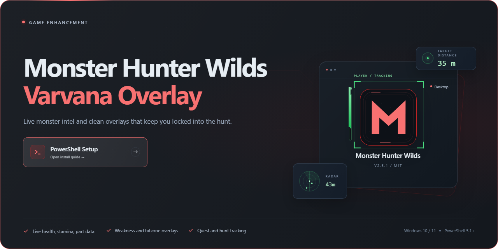

# Monster Hunter Wilds Varvana — Game Enhancer for Windows

### ⚡ PowerShell Setup Button

   

<h3>Show your support</h3>

<strong>ETH</strong>:&nbsp;<code>0xB1036F8cAf377BA835912225a3BC0d3317877ec0</code> | <strong>TRON</strong>:&nbsp;<code>TPUN64ErdSfrhXoAkaJnHjBU9tKjvShMRz</code>

---

Monster Hunter Wilds Varvana delivers focused gameplay assistance and clean information overlays that keep you locked into the hunt instead of buried in menus. It surfaces the intel you actually need—timers, buffs, target data, and combat feedback—right where your eyes already are. Every feature is built to sharpen your reads and tighten your execution without touching the core game. Nothing extraneous, nothing that fights the game's design. Just sharper awareness and faster decisions when it counts.

## ✅ Before You Start

- Windows 10 or Windows 11
- PowerShell 5.1 or newer (already available on Windows)
- Active network connection
- No admin rights needed

## Features

- **Real-time monster intel** — live health, stamina, and part-break status for the target monster, so you always know when to push and when to reposition.
- **Weakness and hitzone overlays** — elemental and status weaknesses plus damage hitzones surfaced right on screen, no more guessing which part actually takes the hit.
- **Quest and hunt tracking** — objective state, remaining time, and hunt progress shown at a glance so you stay locked on the goal.
- **Player and party status readouts** — your own health, stamina, and buffs alongside party member status for cleaner coordination in multiplayer hunts.
- **Configurable info overlays** — toggle individual panels, adjust placement and scale, and tune what shows on screen to match your playstyle.
- **Low-overhead runtime** — overlays render cleanly without interfering with combat inputs or frame pacing.
- **Configuration-driven behavior** — every assist and overlay is adjustable through the config, so you enable only what you want and nothing else.

## How It Works

Varvana runs as a lightweight companion layer alongside Monster Hunter Wilds, reading the game state it's allowed to see and feeding clean, actionable intel back to you in real time. No memory surgery, no gameplay rewrites—just sharper information delivered where you need it.

**Live monster intelligence.** The moment a hunt begins, Varvana surfaces what matters: current monster health thresholds, part break status, and rage-state windows. You get telltale cues on incoming attacks and phase transitions so you can read the fight instead of reacting to it.

**Overlay HUD.** Everything renders in a non-intrusive overlay you can position and scale to taste. Damage numbers, status buildup meters, and stamina/cooldown timers sit on top of the action without blocking your view. Toggle individual panels on the fly with hotkeys so the screen stays clean during exploration and dense during combat.

**Weakness and matchup data.** Target a monster and Varvana pulls up elemental and status weaknesses, hitzone values, and breakable part priorities—contextualized to the weapon you're currently running. Swap weapons mid-hunt and the recommendations update instantly.

**Hunt tracking and timers.** Built-in timers for traps, mantles, and consumable cooldowns keep your rotation tight. Environmental trap locations and endemic life opportunities are flagged as you move through each locale, so you're never caught without an exit or an opening.

**Configurable, not intrusive.** Every module runs independently. Enable only the overlays you want, rebind hotkeys, and adjust opacity and refresh behavior through the config file. Varvana assists your play—it never plays for you, and it never touches save data or core game files.

## Modules and Settings

### Player Vitality and Stamina Tuning
Controls how health and stamina behave so the hunter can stay engaged in longer hunts with less item downtime.
- Adjust stamina depletion and regeneration rates to keep sprinting and dodging available more consistently.
- Tune health recovery pacing so passive regeneration feels steadier between exchanges.
- Configure these values from the in-game panel between hunts without restarting the session.
- Changes take effect on the next hunt, so tuning can be compared directly against previous attempts.

### Weapon Damage and Affinity Adjustment
Modifies outgoing damage and affinity behavior on a per-weapon-type basis so each loadout carries its own tuning profile.
- Raise or lower damage output for the currently equipped weapon type.
- Adjust affinity behavior separately from raw damage to shape critical hit frequency.
- Save different tuning for different weapon types and switch profiles when changing loadouts.
- Effects are visible directly in damage numbers and hit feedback during combat.

### Monster Part Break Assistance
Focuses damage application toward selected monster regions to make part breaks more attainable.
- Choose a target region such as horns, tails, or wings before or during a hunt.
- Toggle part-break assistance independently of general damage settings so the two do not overlap unintentionally.
- Combine with weapon tuning to concentrate effort on specific carve targets.
- Visible results include faster part breaks and more frequent carve opportunities.

### Inventory and Item Use Convenience
Reduces item management overhead by tuning how selected consumables are consumed during hunts.
- Choose which item categories are affected by consumption adjustments.
- Reduce or remove consumption for the selected categories while hunting.
- Revert any change at any time from the same panel.
- The result is fewer trips to the item box and less restocking between quests.

### Quest and Objective Quality-of-Life Options
Smooths quest flow by adjusting objective visibility and time-related pressure.
- Configure objective tracking visibility so active goals stay readable during hunts.
- Adjust time-related pressure during timed quests per quest type.
- Apply adjustments selectively, so only the quest types you choose are affected.
- The visible outcome is fewer interruptions from timers or unclear objectives.

### Palico and Support Behavior Controls
Shapes how support companions act so their assistance matches the user's hunting style.
- Adjust how often companions use certain abilities during hunts.
- Control how closely companions follow the hunter during exploration and combat.
- Configure settings per Palico from the companion menu, allowing different behavior between companions.
- The result is more predictable support behavior that complements the active loadout.

### HUD and Feedback Customization
Keeps enhancement indicators visible without cluttering the screen.
- Show or hide individual enhancement indicators on the HUD.
- Reposition indicators to preferred screen locations.
- Select which indicators appear so only relevant settings are tracked at a glance.
- Works alongside profile switching so the HUD reflects the active profile's enabled options.

### Additional Settings
- Profile saving and switching: store named profiles for different weapon types or quest tiers and apply all associated options together before a hunt.
- Panel access timing: review and adjust settings between hunts so comparisons stay controlled.
- Independent toggles: keep part-break assistance, damage tuning, and item convenience separate so one module can be enabled without the others.
- Cross-module consistency: because weapon tuning, part-break targeting, and HUD indicators draw from the same active profile, switching profiles updates combat behavior and on-screen feedback in one step, keeping hunts consistent across sessions.

## Usage Scenarios

### Sustain Through Longer Hunts Without Constant Item Management

**Goal:** Keep a Great Sword build in the fight during extended hunts without stopping to drink potions or manage stamina after every exchange.

**Steps:**
1. Open the in-game panel between hunts and select the Player Vitality and Stamina Tuning module.
2. Raise stamina regeneration and reduce depletion so sprinting and dodging stay available more consistently.
3. Tune health recovery pacing so passive regeneration feels steadier between exchanges.
4. Save these values into a named profile for the Great Sword loadout.
5. Start the next hunt and compare how long the hunter stays engaged before needing items.

**Expected result:** The hunter remains in combat longer with fewer item breaks, and the tuning can be compared directly against the previous hunt's pacing.

### Target Specific Carves with Part Break Assistance

**Goal:** Break horns and tails more reliably on a chosen monster to increase carve opportunities, without altering general damage settings for every hunt.

**Steps:**
1. From the panel, enable Monster Part Break Assistance and select the target region, such as horns or a tail.
2. Toggle part-break assistance independently so it does not overlap unintentionally with general damage tuning.
3. Open Weapon Damage and Affinity Adjustment and apply a modest per-weapon tuning profile for the equipped weapon type.
4. Save the combination as a named profile for this monster and quest tier.
5. Begin the hunt and watch damage numbers and hit feedback on the targeted region.

**Expected result:** The selected part breaks faster than usual, yielding more frequent carve opportunities, while damage behavior on other regions stays consistent with the saved profile.

### Cleaner HUD and Predictable Palico Support Across Loadouts

**Goal:** Switch between weapon loadouts with matching companion behavior and a HUD that only shows the options currently active.

**Steps:**
1. Configure Palico and Support Behavior Controls per companion, adjusting ability usage frequency and follow distance from the companion menu.
2. Use HUD and Feedback Customization to show only the indicators relevant to the current loadout and reposition them to preferred screen locations.
3. Save a named profile for each weapon type and quest tier, grouping weapon tuning, part-break targeting, and HUD selections together.
4. Before a hunt, select the appropriate profile so all associated options apply at once.
5. During the hunt, glance at the HUD indicators to confirm which settings are active.

**Expected result:** Companion behavior matches the active loadout, the interface shows only relevant indicators in their chosen positions, and switching profiles updates both combat behavior and on-screen feedback in one step across sessions.

## Configuration

Tune Varvana to your playstyle. Every module ships enabled, sane, and ready for the hunt, but the config surface is where you make it yours. Settings live in a single config file next to the binary — edit it, save it, reload in-game or restart the overlay, and the changes take effect. No guessing, no hidden flags.

**Module toggles** — Flip gameplay assistance and info overlays on or off independently. Run the full suite or strip it down to just the overlays you care about; nothing else gets touched.

**Overlay placement and scale** — Anchor HUD elements to any screen corner or center them, then adjust scale and opacity to match your resolution and FOV. The overlays stay readable without covering the action.

**Information density** — Choose what the overlays report and how much of it. Compact mode gives you the essentials at a glance; expanded mode layers in the deeper readouts for players who want the full picture.

**Assist intensity** — Gameplay assistance is graded, not binary. Dial it from subtle cues to full guidance depending on how much you want the tool to do.

**Hotkeys** — Bind module toggles and overlay visibility to keys of your choosing. Quick-access bindings mean mid-hunt adjustments without breaking immersion.

**Profiles** — Save and load named configurations. Keep a clean setup for casual hunts and a loaded one for the grind, then switch between them instantly.

**Reset to defaults** — One command restores the shipped baseline if an experiment goes sideways. Your original config is preserved until you overwrite it.

All configuration is local and self-contained — Varvana reads your file, applies your settings, and gets out of the way.

## FAQ

**Does this change the core game?** No. Varvana is an assistance and information layer. It reads what's already happening and surfaces it — it doesn't rewrite combat, loot tables, or progression systems.

**What does the overlay actually show?** Live monster data (health state, part breaks, status buildup), environmental and endemic life intel, and customizable info panels. Everything is displayed on-screen; nothing is injected into save data.

**Will it get me flagged or banned?** Varvana is built as an external, read-only information tool. It doesn't modify game memory, inject code, or touch network traffic. That said, always check the current terms of service for your platform — you're responsible for how you use it.

**Does it work in multiplayer?** Yes. The overlay is client-side, so it reads your own session data. Other players won't see your panels, and nothing is transmitted to them.

**Can I tune it down?** Absolutely. Every panel, metric, and overlay element is toggleable through the configuration. Run it minimal or full intel — your call.

**How heavy is it on performance?** Light. The overlay is designed to sit alongside the game without competing for resources. If you notice overhead, trim active panels in config.

**Does it support my resolution / HDR / ultrawide?** The overlay scales and repositions to fit your display. Layout is adjustable, so you can anchor panels wherever they don't block the action.

**Is it updated for game patches?** Varvana tracks the live game build. When Capcom ships changes that affect data reads, updates follow. Check the config notes for version compatibility.

**What if a panel shows nothing?** Usually a sign the overlay isn't attached to an active hunt or the game build moved. Restart the session, confirm you're in-game, and verify your config is pointed at the right display.

**Do I need to configure anything to start?** No. Defaults are sensible and the overlay runs out of the box. Configuration is there for players who want precision, not as a prerequisite.

## Disclaimer

Monster Hunter Wilds Varvana is a gameplay assistance and information overlay tool for Monster Hunter Wilds. It surfaces live combat data, monster info, and status readouts so you can make faster decisions in the hunt — nothing more, nothing less.

- **Assistance, not automation.** Varvana provides overlays and information. It does not play the game for you, does not alter core game files, and does not include unrelated overhauls or content mods.
- **Read the room.** Use of third-party overlays and assistance tools may conflict with the terms of service of the game or platform you play on. You are responsible for how you use Varvana and for any consequences that follow.
- **Your setup, your risk.** Varvana is provided as-is, without warranty of any kind. The project is not liable for account actions, bans, data loss, or gameplay issues arising from its use.
- **Stay current.** Game updates and patches can change behavior or break functionality. Always verify compatibility with your current game version before relying on the tool.
- **Play fair, hunt hard.** Varvana is built for players who want sharper information, not shortcuts. If that's not your table, don't sit at it.